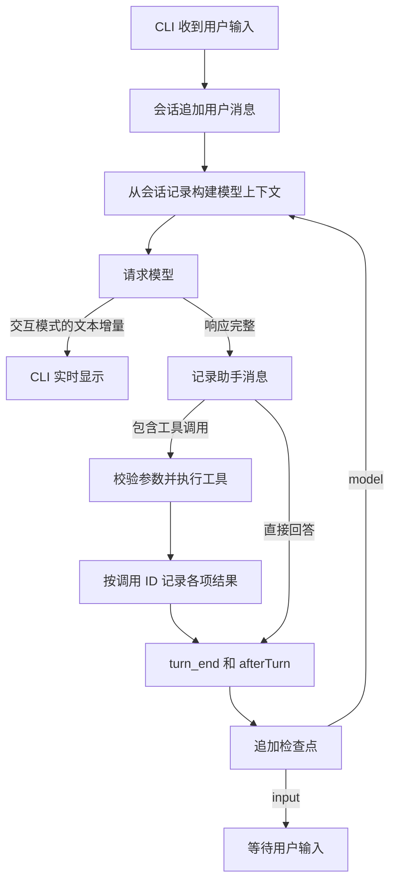

# Theta

Theta 是一个在本地终端里运行的 coding agent。你在项目目录中交给它一个任务，它可以读取代码、修改文件、执行命令，再根据实际结果继续工作。一次任务可以在命令行直接完成，也可以留在同一个会话里继续追问。

Theta 用 TypeScript 和 Bun 重写 Alpha。实现以 Alpha 的 `steps/step1.md` 至 `step7.md` 为基础。Theta 管理工具循环、会话、压缩和检查点，使用 LangChain 消息类型。pi 的模型运行时负责服务商登录和原生协议请求。终端界面支持多行输入、流式回复和工具确认。

## 为什么写 Theta

Alpha 是学习 pi 时写的第一个 demo，用来理解模型如何调用工具、Agent 如何循环、会话如何保存。Theta 沿用七章教程中逐步形成的模块和代码，把它们接到同一个可交互的 CLI 里。比如用户让 Agent 改一行代码，模型刚返回半个工具参数时能否执行？文件已经改了，此时按下 `Ctrl+C` 会发生什么？明天恢复会话时，模型依据什么知道上次做到了哪里？

这三个问题决定了 Theta 的设计：**工具只执行完整调用，会话记录实际发生的事，每次模型请求都有可追溯的上下文。** 想了解项目参考的原始设计，可以阅读 [pi](https://github.com/earendil-works/pi)。

## 在终端中使用

在 Theta 源码目录安装依赖并注册命令。确保 Bun 的全局可执行文件目录（`bun pm bin -g`）在 `PATH` 中。

```sh
bun install --frozen-lockfile --ignore-scripts
bun run check
bun test
bun link
theta --help
```

### 登录并开始对话

运行 `theta` 打开 TUI，输入 `/login`，选择登录方式、服务商和模型。已有服务商环境凭据时可直接输入 `/model`。也可以在 shell 中完成这些操作。

```sh
theta providers                 # 查看当前版本实际提供的服务商和登录方式
theta login deepseek            # 输入 API Key，再选择模型
theta login openai-codex oauth   # 使用 ChatGPT 账号，选择浏览器或设备码授权
theta status                    # 查看当前模型和凭据来源
theta model                     # 从已配置的服务商中切换模型
theta logout deepseek           # 删除保存在 Theta 的 DeepSeek 凭据
```

上面的两个登录命令可任选一个。服务商列表和登录步骤来自 pi，支持 API Key、OAuth 浏览器回调、手动授权码、设备码，以及 AWS 和 Google Cloud 等服务的环境凭据。密钥和手动授权码在输入时遮蔽。Theta 把凭据保存在 `~/.theta/auth.json`（新建文件权限为 `0600`），把所选模型保存在 `~/.theta/settings.json`。OAuth 刷新由 pi 在请求时处理。可用 `theta --theta-home <目录>` 指定独立的账号目录。原来通过 `THETA_HOME` 指定的目录可以直接作为参数传入。`models.json` 沿用 pi 的服务商配置格式，可连接本地模型或自定义网关。

### 通过环境变量使用兼容接口

原有 OpenAI 兼容配置仍可通过环境变量或**启动目录**中的 `.env` 使用。首次启动时会采用这组配置；选定目录模型后，后续任务使用所选模型。运行 `theta model env` 可以切回环境配置。也可以在源码目录执行 `bun run start "任务"`。

配置自定义网关后，`OPENAI_API_KEY` 随该端点用于兼容模式。若要用目录中的 OpenAI 模型，请单独用 `theta login openai` 配置凭据。

| 配置项 | 含义 |
| --- | --- |
| `OPENAI_API_KEY` | 环境配置方式使用的模型服务 API 密钥 |
| `OPENAI_MODEL` | 支持 Chat Completions 和函数调用的模型 ID。交互模式还需要支持流式响应 |
| `OPENAI_BASE_URL` | 兼容服务的 API 根地址，包含服务商要求的路径前缀。省略时使用 OpenAI 默认地址 |
| `THETA_CONTEXT_WINDOW` | 可选，上下文窗口的 token 数，默认 32768，最小 8192。请按所用模型填写 |
| `THETA_COMPACT_AT` | 尝试压缩的估算 token 数，默认取消息预算的 75% |
| `THETA_DEBUG_CONTEXT=1` | 打印主请求序号、消息条数和经 Hook 调整后的消息。摘要请求单独记录 |
| `THETA_READ_ONLY=1` | 通过 beforeTool 仅放行 read，其余调用返回 denied |
| `THETA_STOP_AFTER_TURN=1` | 第一批工具结果保存后，由 afterTurn 停止当前任务并等待新输入 |

以上五个 `THETA_*` 配置也接受 Alpha 七章使用的同名 `ALPHA_*` 变量。例如，原有的 `ALPHA_READ_ONLY=1` 会继续限制工具执行。两种前缀同时设置时采用 `THETA_*` 的值。

随后切换到要处理的项目目录运行 Theta。

| 入口 | 用途 |
| --- | --- |
| `theta "读取 package.json，说明如何运行项目"` | 执行一次任务，成功后将最终回答写入 stdout |
| `theta` | 打开 TUI。顶部显示工作目录，中间滚动查看对话和工具结果，底部输入任务。管道输入使用逐行模式 |
| `theta --session <文件> "新问题"` | 在等待输入的检查点追加新的用户任务 |
| `theta --resume <文件>` | 在等待模型的检查点继续原任务，沿用已经完成的轮数 |
| `theta --resume` | 打开当前目录最近写入的会话。等待模型时继续原任务，等待用户时进入交互 |
| `/resume`、`/new` | 在交互模式中继续中断的任务，或让下一条输入开启新会话 |
| `/compact` | 在交互会话中生成历史摘要，缩短后续请求的上下文 |
| `/login`、`/logout`、`/model`、`/status` | 在 TUI 中管理服务商登录、切换模型、查看当前会话文件；切换模型后可在同一段历史上继续 |
| `Enter`、`Ctrl+J`、`↑` | 发送、多行输入、在空输入框中调出上一条输入 |
| `Ctrl+C` | 运行中取消当前任务；交互模式下回到输入提示符 |
| `/exit` | 退出交互会话，已保存的记录可供下次恢复 |

例如，某个项目刚把启动脚本从 `dev` 改为 `start`，README 里的命令还没同步。下面是一次预期交互的简化示例：

```text
$ theta
› 对照 package.json，把 README 里的启动命令改对，只动那一行。
  read · 完成
  read · 完成
允许执行 edit？  （选择“允许本次”）
  edit · 完成
  read · 完成
已将启动命令从 bun run dev 改为 bun run start，并重新读取了修改后的段落。

> 刚才为什么选 start？
package.json 的 scripts 定义了 start，README 原来引用的是 dev。

> /exit
```

普通输入交给模型，`/help` 可查看本地命令。TUI 在执行 `write`、`edit`、`bash` 前展示参数，用 `PageUp` 和 `PageDown` 可滚动查看。审批时按 `Esc` 取消本次任务，工具结果保存后可以在原会话继续输入。`read` 会拒绝读取默认和当前账号目录中的 `auth.json`、`models.json`。单次命令和管道模式可用 `THETA_READ_ONLY=1` 限制为只读。工具在本机以运行 Theta 的用户权限工作，相对路径以启动目录为基准。读取的代码和命令输出可能进入后续模型请求。

交互会话逐段显示模型文本，完成后排版 Markdown。单次任务（包括指定文件续问和恢复待完成任务）等最终回答和检查点保存成功后才向 stdout 输出答案，诊断信息走 stderr。目录模型使用对应服务商的协议，环境配置方式使用 Chat Completions。

## 一次任务如何运行

Theta 将一次用户输入到最终回答称为一次**运行**。一次运行可以有多**轮**，每轮包括一次模型请求，以及这次响应要求执行的工具。同一**会话**可以跨越多次运行，也可以在进程退出后恢复。



以示例中的 `edit` 为例，模型可能分多个片段返回路径、旧文本和新文本。**模型适配层**负责按调用拼接片段；**Agent 循环**等响应完整后才把调用交给工具；**工具**检查参数、执行替换并返回结果；**会话层**记录助手发起的调用和对应结果。CLI 可以边接收边显示文本，存储层只需保存成形的消息。这样，终端刷新方式和模型服务的分片方式都不会改变会话历史。

## 内置工具

| 工具 | 用途 | 模型从结果中知道什么 |
| --- | --- | --- |
| `read` | 按行读取 1 MB 以内的文本文件；可指定从 1 开始的 `offset` 和行数 `limit` | 较长结果标出行范围和下一页的 `offset`；单行超长时标明只展示开头 |
| `write` | 创建文件，或整体写入已有文件 | 本次写入是否完成 |
| `edit` | 按旧文本定位并局部替换 | 替换是否成功；旧文本缺失或匹配多处时，模型可以重新读取并选取更准确的片段 |
| `bash` | 在工作目录执行 shell 命令 | 返回退出状态与输出前缀。stdout、stderr 各自上限 1,000,000 字节，任一超限即终止命令并返回工具错误 |

一次响应可以请求多个工具。每个结果都通过调用 ID 对应到原始请求。上例中 `edit` 成功表明替换已执行，随后 `read` 才提供修改后的文件内容；如果还要确认项目能否启动，则需要实际运行相应命令。

## 会话、恢复与压缩

**磁盘上保存了什么？** 会话位于启动目录下的 `.theta/sessions/<会话 ID>.jsonl`。Step 7 的 v3 格式按行追加，头部记录实际工作目录，首条消息保存系统指令。工具结果通过调用 ID 配对。检查点保存 `afterEntryId`、`next`、`turns` 和 `maxTurns`。一个会话文件由一个进程写入。

**下一次请求会发送什么？** 首次压缩前，Theta 根据当前会话路径组装历史消息。执行 `/compact` 或接近上下文预算时，它将较早的完整交互汇总成摘要，追加一条压缩记录，并记下从哪条消息起保留原文。下一次请求携带系统指令、摘要和近期原文。当最近一次任务本身达到压缩阈值，或旧任务摘要加上当前任务仍超过预算时，Theta 可以继续汇总当前任务中已完成的较早工具轮次。下一次摘要请求沿用刚生成的摘要，只补充新切点之前尚未汇总的记录。记录中的 `taskEntryId` 指向原始用户输入，`firstKeptEntryId` 指向保留的工具轮次。重启后仍能看到原始目标和最近一整批工具调用及结果。旧记录仍留在磁盘上，便于回看原始输出。

**取消或恢复意味着什么？** 用户输入落盘后，Theta 保存第 0 轮的等待模型检查点。首轮断线后可用 `--resume` 重试同一份输入。旧 v3 文件若在等待输入的检查点后只留下用户消息，也能继续。独立落盘的有效摘要只更新上下文，恢复时沿用原有轮数。例如，第 1 轮的写入结果已保存，文件末尾是 `model 1/8` 检查点。此时退出，`--resume <文件>` 会带着该结果发起第 2 次请求。若进程在写入调用落盘后、结果保存前退出，加载器会报告末条记录并拒绝自动继续。此时可在新会话中读取目标文件核实。在 TUI 工具确认时按 `Esc` 或 `Ctrl+C` 会取消任务。Theta 保存本轮结果和等待输入的检查点，然后在原会话提示输入。

预算按序列化后的 UTF-8 字节数估算。扣除工具声明、输出和余量后，消息达到可用预算的 75% 时尝试压缩。有可汇总的早期任务或完整工具轮次、且摘要能缩短上下文时，Theta 才追加压缩记录。单批近期消息本身超过预算时，CLI 会报告原因。

## 按 Alpha 的七章阅读源码

| 章节 | 在 Theta 中追踪的调用 |
| --- | --- |
| Step 1 · 模型与循环 | [Agent](src/agent/agent.ts) 启动 [runLoop](src/agent/agent-loop.ts)，模型适配器按 [ModelIO 契约](src/models/model-io.ts) 聚合流式消息，[protocol](src/agent/protocol.ts) 检查工具调用及配对 |
| Step 2 · 工具 | [dispatch](src/agent/dispatch.ts) 查找工具，按 [工具契约](src/agent/tools.ts) 校验参数，串行执行并返回 ToolMessage |
| Step 3 · Hook 与事件 | [hooks](src/agent/hooks.ts) 定义五个策略位置，[events](src/agent/events.ts) 定义 CLI 与会话层订阅的通知 |
| Step 4 · 会话 | [AgentSession](src/coding-agent/agent-session.ts) 等待消息保存，[SessionManager](src/coding-agent/session-manager.ts) 追加 JSONL，[codec](src/coding-agent/message-codec.ts) 恢复 LangChain 消息实例 |
| Step 5 · 上下文 | [SessionManager.getContextSnapshot](src/coding-agent/session-manager.ts) 选出并复制系统消息、当前摘要和近期记录。[contextMessages](src/coding-agent/context.ts) 将快照转换为本轮消息，供预算估算和模型请求共用 |
| Step 6 · 压缩 | [prepareRequestContext](src/coding-agent/compact.ts) 汇总旧任务或当前任务内较早的完整工具轮次，[AgentSession](src/coding-agent/agent-session.ts) 等压缩记录保存后才将摘要和近期消息交给执行循环 |
| Step 7 · 检查点 | [checkpoint](src/coding-agent/checkpoint.ts) 检查历史位置、工具配对和剩余轮数，[终端任务入口](src/cli/task-mode.ts) 分别进入 prompt 或 resume |

## 运行行为

| 阶段 | 交付范围 | 可观察的完成条件 |
| --- | --- | --- |
| CLI 与 TUI | 单次任务、管道输入、多行对话、服务商登录和模型切换 | 单次任务只输出最终回答。交互时文本逐段出现，取消后可以继续输入 |
| v1 · Agent 循环 | 四个内置工具、参数校验、结果回传、多轮执行 | 一次输入即可完成“读取 → 修改 → 复查”，工具失败时模型能看到具体原因 |
| v1 · 会话恢复 | JSONL 持久化、按工作目录恢复最近会话 | 退出并重启后能接着上次的文件修改继续讨论，已执行的命令不会因恢复而重放 |
| v1 · 上下文压缩 | 手动压缩、预算触发、摘要与近期记录拼接 | 压缩后仍能说明当前目标和未完成事项，原始工具结果可从会话记录查阅 |

### v1 之后

- **会话分支。** 通过文本命令 `/tree` 选择历史节点，从同一个问题尝试两种方案。后续请求沿选中节点的父链构建上下文，每个分支使用自己路径上的消息与摘要。
- **运行中追加指令。** `steer` 用于纠正当前任务，例如读文件时追加“只分析启动流程”，在本轮工具执行结束后调整下一轮请求。`followUp` 用于排入另一项任务，例如“完成后再汇总依赖”，等当前任务自然结束再执行。

两个阶段都沿用终端入口。
